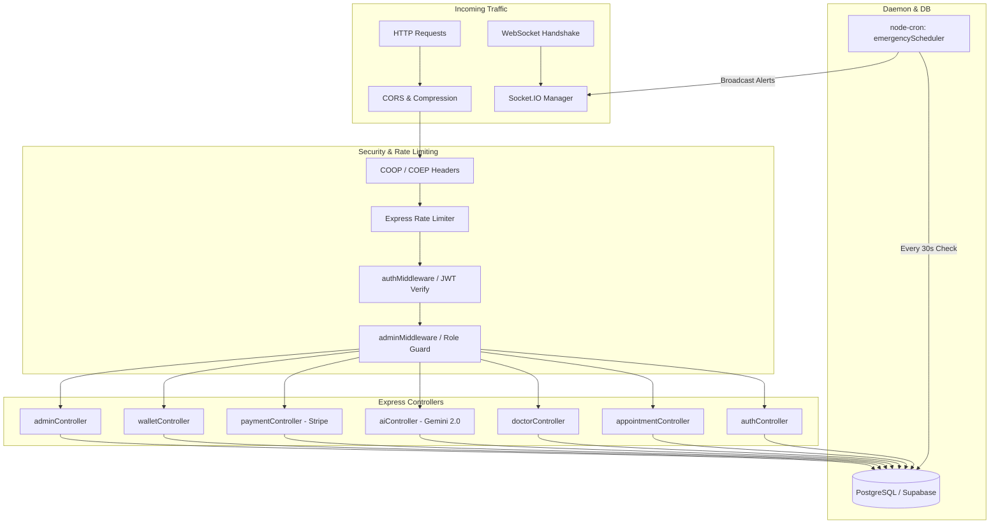
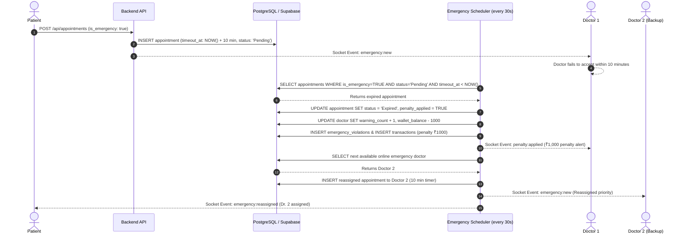

# ⚙️ Backend Workflow — MediConnect Elite

## 1. Architecture Overview

The backend is built with **Node.js 20+** and **Express 4**. It coordinates business logic, enforces doctor emergency SLAs via background cron jobs, manages WebSocket rooms with **Socket.IO**, and connects to **PostgreSQL / Supabase** for data persistence.



---

## 2. Directory Structure

```
backend/
├── controllers/
│   ├── adminController.js       # Admin KPIs, doctor oversight, penalty reversal
│   ├── aiController.js          # Google Gemini 2.0 Flash medical conversational AI
│   ├── appointmentController.js # Appointment booking, conflict check, cancellation, completion
│   ├── authController.js        # Register, login, password reset OTP, Google OAuth
│   ├── doctorController.js      # Doctor directory, search, availability toggle
│   ├── documentController.js    # Medical record uploads via Multer
│   ├── notificationController.js# Notification feeds & read markers
│   ├── paymentController.js     # Stripe checkout session creation & webhook/verify
│   ├── prescriptionController.js# Digital prescription issuance & retrieval
│   ├── reviewController.js      # Doctor rating & feedback
│   ├── userController.js        # Profile settings, activity logs, referral bonuses
│   └── walletController.js      # Ledger balances, consultations credits, withdrawals
├── jobs/
│   └── emergencyScheduler.js    # Cron worker running every 30 seconds for SLA enforcement
├── middleware/
│   ├── authMiddleware.js        # JWT token verification
│   ├── adminMiddleware.js       # Verifies role == 'admin'
│   ├── premiumMiddleware.js     # Checks user subscription status
│   └── rateLimiter.js           # IP-based rate limiting per endpoint
├── routes/                      # Route maps attached to Express app
├── uploads/                     # Multer static file destination
├── db.js                        # PostgreSQL connection pool (pg.Pool)
├── socketManager.js             # Real-time WebSocket room assignment & event emission
├── supabaseClient.js            # Supabase JavaScript client instance with ws transport
└── server.js                    # Server bootstrap, HTTP listener, and cron activation
```

---

## 3. Emergency SOS Lifecycle & Background Job

The core differentiator of MediConnect is the **10-minute Emergency SLA**:



---

## 4. Environment Configuration

Defined in [backend/.env](file:///D:/PROJECT_S/MediConnect%20Elite/MediConnect/backend/.env):

```env
PORT=5000
NODE_ENV=development
JWT_SECRET=supersecretmediconnectjwtkey2026developmentmin32chars
CLIENT_URL=http://localhost:5173
FRONTEND_URL=http://localhost:5173

# Stripe Payment Gateway
STRIPE_SECRET_KEY=sk_test_...

# Google AI Studio (Gemini 2.0 Flash)
GEMINI_API_KEY=your_gemini_api_key

# Supabase Database & REST Gateway
SUPABASE_URL=https://rmfzydycexyuhqskklgu.supabase.co
SUPABASE_PUBLISHABLE_KEY=sb_publishable_Q9yJIk54WyB4jsiBOx2OWQ_ie1YTWBt
REACT_APP_SUPABASE_URL=https://rmfzydycexyuhqskklgu.supabase.co
REACT_APP_SUPABASE_PUBLISHABLE_KEY=sb_publishable_Q9yJIk54WyB4jsiBOx2OWQ_ie1YTWBt
```

---

## 5. Development & Run Commands

```bash
# 1. Install dependencies
cd backend
npm install

# 2. Run backend server
node server.js
# Or with automatic reload during development:
npm run dev

# 3. Test API Health
curl http://localhost:5000/api/health
```
