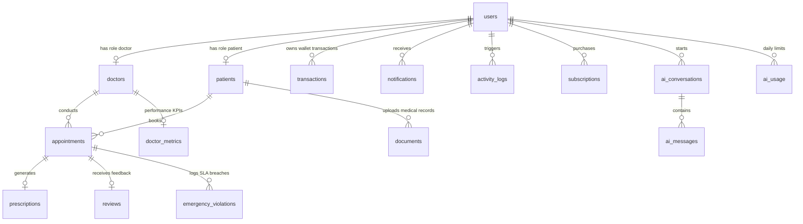
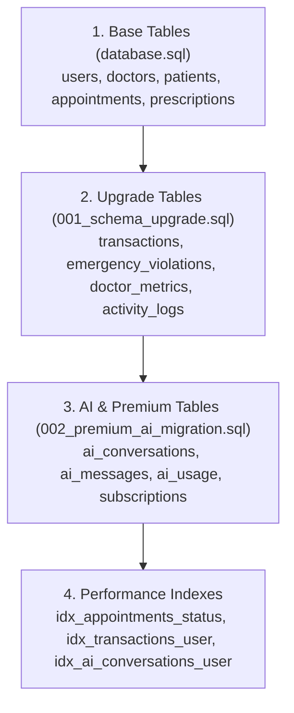

# 🗄️ Database Workflow — MediConnect Elite (Supabase / PostgreSQL)

## 1. Entity Relationship (ER) Diagram



---

## 2. Table Specifications

### Core User & Medical Profiles
| Table | Description | Primary Key | Foreign Keys |
| :--- | :--- | :--- | :--- |
| `users` | Base account credentials, role (`patient`, `doctor`, `admin`), wallet, referral info. | `id` | - |
| `doctors` | Professional details, specialization, fees, emergency active status, warning counts. | `id` | `user_id` → `users.id` |
| `patients` | Personal medical records, DOB, blood group, medical history. | `id` | `user_id` → `users.id` |

### Consultations & Emergency
| Table | Description | Primary Key | Foreign Keys |
| :--- | :--- | :--- | :--- |
| `appointments` | Booked sessions, status (`Pending`, `Confirmed`, `Completed`, `Cancelled`, `Expired`), emergency flag, timeout timer, Jitsi room link. | `id` | `patient_id` → `patients.id`, `doctor_id` → `doctors.id` |
| `emergency_violations`| Logs SLA timeouts and rejections, calculates financial penalties. | `id` | `doctor_id` → `doctors.id`, `appointment_id` → `appointments.id` |
| `doctor_metrics` | Live reliability scores, response times, penalty counts. | `id` | `doctor_id` → `doctors.id` |
| `prescriptions` | Structured medication dosages, frequency, notes issued by doctor. | `id` | `appointment_id` → `appointments.id`, `doctor_id` → `doctors.id`, `patient_id` → `patients.id` |
| `reviews` | Patient feedback, rating (1-5), comments for completed sessions. | `id` | `appointment_id` → `appointments.id`, `doctor_id` → `doctors.id` |
| `documents` | Uploaded test reports and medical files. | `id` | `patient_id` → `patients.id` |

### Financial & Audit Ledger
| Table | Description | Primary Key | Foreign Keys |
| :--- | :--- | :--- | :--- |
| `transactions` | Immutable financial ledger: consultations, penalties, refunds, subscriptions. | `id` | `user_id` → `users.id` |
| `subscriptions` | Stripe subscription tracking (`monthly`, `annual`), validity dates. | `id` | `user_id` → `users.id` |
| `notifications` | In-app alerts, priority tags, read status. | `id` | `user_id` → `users.id` |
| `activity_logs` | Audit trail of security, booking, and administrative events. | `id` | `user_id` → `users.id` |

### AI Conversation Engine
| Table | Description | Primary Key | Foreign Keys |
| :--- | :--- | :--- | :--- |
| `ai_conversations` | Grouped chat threads with Gemini 2.0 Flash. | `id` | `user_id` → `users.id` |
| `ai_messages` | Individual prompt/response history. | `id` | `conversation_id` → `ai_conversations.id` |
| `ai_usage` | Daily rate limiting quotas for standard vs premium tiers. | `id` | `user_id` → `users.id` |

---

## 3. Migration Execution Order

When deploying to a fresh Supabase database instance:



> [!TIP]
> A consolidated, single-file migration script containing all three stages in correct dependency order is provided at [migrate-database.sql](file:///D:/PROJECT_S/MediConnect%20Elite/MediConnect/workflows/scripts/migrate-database.sql).

---

## 4. Applying Migrations to Supabase

1. Open your [Supabase SQL Editor](https://supabase.com/dashboard/project/rmfzydycexyuhqskklgu/sql).
2. Copy the contents of [workflows/scripts/migrate-database.sql](file:///D:/PROJECT_S/MediConnect%20Elite/MediConnect/workflows/scripts/migrate-database.sql).
3. Paste into the SQL editor and click **Run**.
4. All tables, check constraints, foreign keys, and indexes will be created.

---

## 5. Security & Row Level Security (RLS) Guidelines

- For tables exposed to the client-side REST API, enable RLS:
  ```sql
  ALTER TABLE appointments ENABLE ROW LEVEL SECURITY;
  ALTER TABLE prescriptions ENABLE ROW LEVEL SECURITY;
  ALTER TABLE transactions ENABLE ROW LEVEL SECURITY;
  ```
- Use role-specific policies (`TO authenticated` combined with ownership checks):
  ```sql
  CREATE POLICY "Users can only view their own transactions"
    ON transactions
    FOR SELECT
    TO authenticated
    USING ((SELECT auth.uid())::text = user_id::text);
  ```
- Backend Express services connect via direct connection string / pooler or API key to perform transactional writes.
