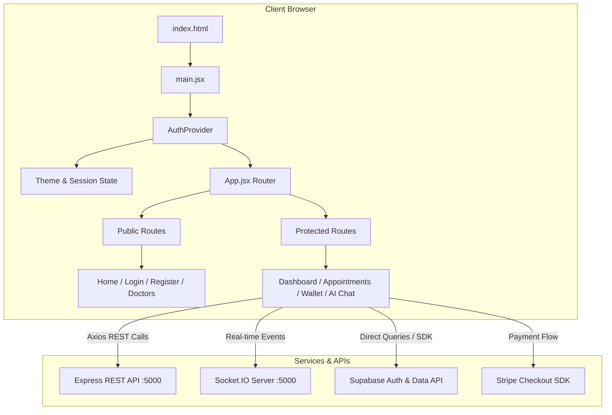

# 🖥️ Frontend Workflow — MediConnect Elite

## 1. Architecture Overview

The frontend is a Single-Page Application (SPA) built with **React 19**, **Vite 7**, and **TailwindCSS 3/4**. It uses **React Router DOM 7** for declarative client-side routing, **Framer Motion** for glassmorphism animations, and **Socket.IO-client** for real-time bidirectional communication.



---

## 2. Component & Directory Structure

```
frontend/src/
├── components/
│   ├── ui/                   # Shared UI primitives (GlassCard, GradientText, ParticleBackground)
│   ├── Navbar.jsx            # Dynamic navigation (Auth state, theme toggle, notifications)
│   ├── ChatBot.jsx           # AI Health Bot floating drawer
│   ├── AIHealthAssistant.jsx # Full-screen interactive AI consultation
│   ├── BookingModal.jsx      # Doctor appointment slot picker & booking
│   ├── PrescriptionModal.jsx # Digital prescription viewer/downloader
│   ├── RecordsModal.jsx      # Medical documents & history upload
│   ├── RescheduleModal.jsx   # Appointment reschedule dialog
│   └── ReviewModal.jsx       # Doctor feedback & star rating modal
├── context/
│   └── AuthContext.jsx       # Global session, JWT token, theme (dark/light/premium), socket init
├── pages/
│   ├── Home.jsx              # Landing page with hero & features
│   ├── Login.jsx             # Email/Password + Google OAuth login
│   ├── Register.jsx          # Role-based onboarding (Patient / Doctor)
│   ├── Dashboard.jsx         # Role-specific dashboard (Patient view / Doctor queue / Admin)
│   ├── Doctors.jsx           # Doctor directory with emergency badge & booking
│   ├── MyAppointments.jsx    # Appointment manager with Jitsi teleconsultation launch
│   ├── Wallet.jsx            # Elite wallet balance, transaction ledger, payout request
│   ├── Subscribe.jsx         # Premium membership plans with Stripe checkout
│   ├── PremiumPerks.jsx      # Referral rewards & priority support
│   └── Profile.jsx           # Profile details & avatar editor
├── supabaseClient.js         # Configured @supabase/supabase-js instance
├── App.jsx                   # Central routing & transition manager
└── main.jsx                  # React DOM root render
```

---

## 3. Runtime Lifecycle & Authentication Flow

1. **Bootstrap (`main.jsx`)**:
   - Loads global CSS design tokens (`index.css`), Toast notifications container, and Google OAuth Provider.
2. **Session Initialization (`AuthContext.jsx`)**:
   - Inspects `localStorage` for `token` (JWT).
   - If present, invokes `GET /api/users/profile` to validate credentials.
   - Syncs active theme (`dark`, `light`, or `premium` Gold for subscribed users).
   - Initializes Socket.IO connection: `io(backendUrl, { auth: { token } })`.
3. **Route Guards (`ProtectedRoute`)**:
   - Validates user authentication.
   - Unauthenticated visitors are redirected to `/login` preserving intended destination in navigation state.
4. **Real-time Event Listeners**:
   - `appointment:status_update` → Updates UI state without requiring page reload.
   - `emergency:new` → Triggers audio alert & priority banner for doctors.
   - `penalty:applied` → Alerts doctor of SLA timeout or violation.

---

## 4. Environment Configuration

Defined in [frontend/.env](file:///D:/PROJECT_S/MediConnect%20Elite/MediConnect/frontend/.env):

```env
# Backend Express URL
VITE_API_URL=http://localhost:5000

# Supabase Gateway
VITE_SUPABASE_URL=https://rmfzydycexyuhqskklgu.supabase.co
VITE_SUPABASE_PUBLISHABLE_KEY=sb_publishable_Q9yJIk54WyB4jsiBOx2OWQ_ie1YTWBt
VITE_SUPABASE_ANON_KEY=sb_publishable_Q9yJIk54WyB4jsiBOx2OWQ_ie1YTWBt

# Compatibility Fallback
REACT_APP_SUPABASE_URL=https://rmfzydycexyuhqskklgu.supabase.co
REACT_APP_SUPABASE_PUBLISHABLE_KEY=sb_publishable_Q9yJIk54WyB4jsiBOx2OWQ_ie1YTWBt
```

---

## 5. Development & Build Commands

```bash
# 1. Install dependencies
cd frontend
npm install

# 2. Run local development server (Vite on :5173)
npm run dev -- --host

# 3. Production build (Outputs to frontend/dist)
npm run build

# 4. Preview production build locally
npm run preview
```
