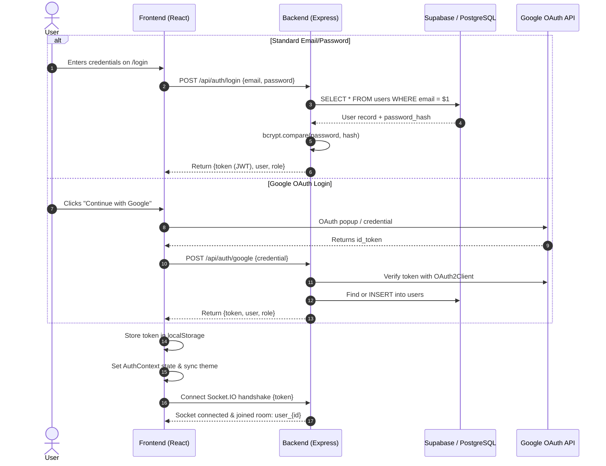
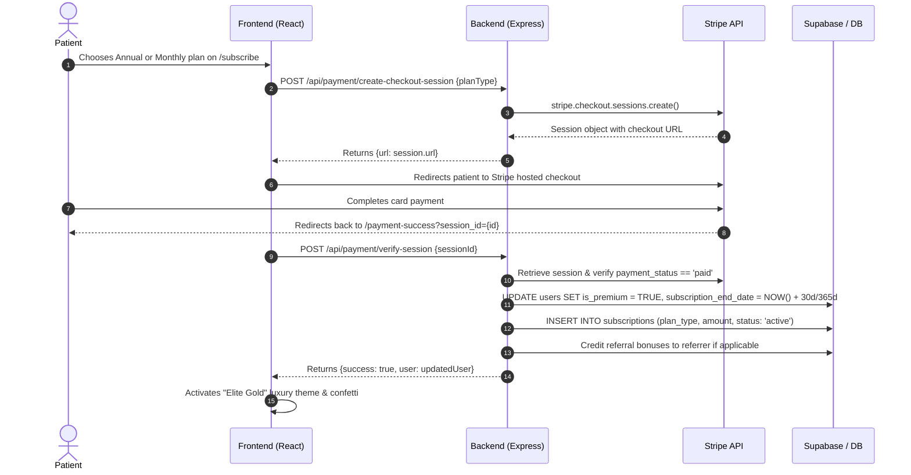
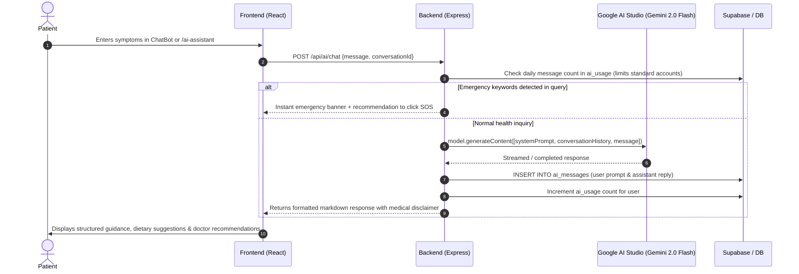

# 🔄 System Integration Workflow — MediConnect Elite

This document details how the **Frontend**, **Backend**, and **Database** communicate during primary user journeys.

---

## 1. Authentication & Session Workflow



---

## 2. Doctor Consultation & Jitsi Video Call Workflow

```mermaid
sequenceDiagram
    autonumber
    actor Patient
    actor Doctor
    participant FE as Frontend (React)
    participant BE as Backend (Express)
    participant SB as Supabase / DB
    participant Jitsi as Jitsi Meet Server

    Patient->>FE: Selects Doctor & picks slot on /doctors
    FE->>BE: POST /api/appointments {doctorId, date, time}
    BE->>SB: Check existing slots for collisions
    BE->>SB: INSERT INTO appointments (status: 'Pending', meeting_link: 'uuid')
    BE-->>Doctor: Socket: appointment:new
    Doctor->>FE: Views appointment queue on /dashboard
    Doctor->>BE: PUT /api/appointments/:id/status {status: 'Confirmed'}
    BE->>SB: UPDATE appointments SET status = 'Confirmed'
    BE-->>Patient: Socket: appointment:status_update

    Note over Patient,Doctor: Scheduled Time Arrives
    Patient->>FE: Clicks "Join Call" on /my-appointments
    Doctor->>FE: Clicks "Start Call" on /dashboard
    FE->>Jitsi: Launch embedded iframe (room: mediconnect-consult-{id})
    Patient<-->>Doctor: Encrypted P2P Video/Audio Consultation

    Doctor->>FE: Clicks "Complete Consultation" & writes prescription
    FE->>BE: POST /api/prescriptions + PUT /api/appointments/:id/status
    BE->>SB: Credit Doctor wallet balance (+ fee)
    BE->>SB: INSERT INTO transactions (type: 'consultation')
```

---

## 3. Stripe Subscription & Elite Upgrade Workflow



---

## 4. Gemini 2.0 Flash AI Symptom Checker Workflow


